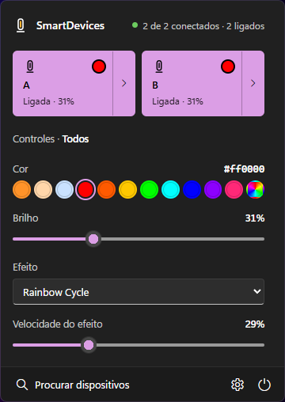

# SmartDevices

Controle aparelhos inteligentes pelo PC com Windows, sem o app do celular. Fica como um ícone
na bandeja, perto do relógio, e abre um painel no estilo das Configurações Rápidas do Windows 11.

Hoje controla as lâmpadas e fitas de LED do app **Lotus Lamp / Lotus Lamp X / Lotus Lantern**
(protocolo ELK-BLEDOM, 24 modelos) por Bluetooth. A arquitetura foi feita para receber outros
aparelhos, como tomadas e ar-condicionado, adicionando apenas um arquivo de driver.



## Recursos

- Ligar e desligar cada aparelho ou todos de uma vez, pela bandeja ou pelo painel
- Cor (paleta com brancos quente, neutro e frio, ou qualquer cor), brilho, efeitos e velocidade
- Controlar um aparelho sozinho ou todos juntos
- Reconexão automática, com intervalos crescentes para não ocupar o Bluetooth à toa
- Ícone que mostra o estado: ponto laranja com luz acesa, apagado sem conexão
- Segue o tema claro/escuro e a cor de destaque do Windows; funciona com teclado e leitor de tela
- Opção de iniciar com o Windows
- Menu de terminal como alternativa ao painel

## Requisitos

- Windows 10 ou 11 com Bluetooth LE
- Python 3.10 ou mais novo ([python.org](https://www.python.org/downloads/) ou `winget install Python.Python.3.12`)
- WebView2 (já vem no Windows 11)

## Instalação

```powershell
git clone https://github.com/dockst3r/SmartDevices.git
cd SmartDevices
python -m venv .venv
.venv\Scripts\pip install -r requirements.txt
```

Ou apenas dê dois cliques em `SmartDevices (terminal).bat`, que cria o ambiente na primeira vez.

## Uso

| Arquivo | O que abre |
|---|---|
| `SmartDevices.vbs` | Ícone na bandeja e painel, sem janela de console |
| `SmartDevices (terminal).bat` | Menu numerado no terminal |

1. **Feche o app do aparelho no celular.** Cada lâmpada aceita só uma conexão por vez.
2. Abra o SmartDevices e clique em **Procurar dispositivos**. Adicione os aparelhos e dê apelidos.
3. Clique no bloco de um aparelho para ligar ou desligar. A seta `›` mostra os controles só dele.

Na bandeja, o botão direito traz Ligar tudo, Desligar tudo, Procurar, Iniciar com o Windows e **Sair**.
Fechar o painel não desconecta nada; só Sair desconecta e encerra. Use o painel ou o terminal, não os
dois ao mesmo tempo.

### Se algo não funcionar

- **Brilho não muda:** em Configurações, troque "Como ajustar o brilho" para "Escurecendo a cor".
- **Comandos sem efeito:** em Configurações, escolha o modelo certo em vez de "Modelo automático".
- **Aparelho não aparece ou não conecta:** confira se o app do celular está fechado e se o aparelho está ligado.
- Detalhes ficam em `smartdevices.log`. Para mais informação, defina `SMART_DEBUG=1` antes de abrir.

## Arquitetura

```
 Interfaces      tray.py + ui/ (bandeja e painel)        smart.py (terminal)
                         \                                  /
 Núcleo                    core/hub.py   ← único ponto de entrada; não conhece tipos de aparelho
                         /        |         \
                core/device.py  core/discovery.py  core/storage.py
                (contrato)      (busca por transporte) (devices.json, settings.json)
                         |
 Transportes     core/ble.py (Bluetooth LE)        … wifi.py, ir.py no futuro
                         |
 Drivers         drivers/elk_bledom.py (Lotus Lamp) … qualquer arquivo novo em drivers/
```

As interfaces nunca falam com um driver diretamente. Cada aparelho diz **o que sabe fazer**
(`actions()`), e o painel e o terminal desenham os controles a partir disso: número vira slider,
lista vira seletor, cor vira paleta, sim/não vira chave. Um aparelho novo aparece nas duas
interfaces sem mudar nenhuma delas.

### Contrato de um driver (`core/device.py`)

| Peça | Para quê |
|---|---|
| `transport` | `"ble"`, `"wifi"`, `"ir"`… liga o driver à busca certa |
| `category` | `light`, `plug`, `climate`, `sensor`, `other`; define o ícone |
| `match(advert)` | pontuação > 0 se o driver reconhece o aparelho encontrado na busca |
| `actions()` | `Action(key, label, params)`; `Param.kind` = `int`, `choice`, `color`, `bool` |
| `run(key, **values)` | executa a ação no aparelho |
| `on` / `off` | viram o botão do bloco e entram em "Ligar/Desligar tudo" |
| `options()` | ajustes do aparelho mostrados nas Configurações (salvos em `config`) |
| `state` / `remember()` / `summary()` / `swatch()` | último estado, linha do bloco, cor da bolinha |
| `on_change()` | avise quando algo mudar sozinho (queda de conexão, sensor) |

`BleDevice` (`core/ble.py`) cuida de conexão, nova tentativa, reconexão e de `write_interval`:
muitos controladores baratos descartam comandos que chegam colados, então o driver define o
intervalo mínimo entre escritas (0,3 s nas lâmpadas ELK).

## Adicionar um aparelho

### Bluetooth: um arquivo em `drivers/`

```python
from core.ble import BleDevice
from core.device import Action, Advert, register

WRITE = "0000ffe1-0000-1000-8000-00805f9b34fb"

@register
class TomadaXyz(BleDevice):
    driver_id = "tomada_xyz"
    driver_label = "Tomada XYZ"
    category = "plug"

    @classmethod
    def match(cls, adv: Advert) -> int:
        return 10 if adv.name.startswith("XYZ-PLUG") else 0

    def actions(self):
        return [Action("on", "Ligar"), Action("off", "Desligar")]

    async def run(self, action_key, **values):
        await self.write(WRITE, bytes([0x01 if action_key == "on" else 0x00]))
```

O arquivo é carregado sozinho na próxima vez que o app abrir.

### Outro transporte (ex.: ar-condicionado por Wi-Fi)

1. Crie `core/wifi.py` com uma `Discovery` (`transport = "wifi"`, `@register_discovery`) que devolve
   `Advert`s, e uma base `WifiDevice(Device)` com `connect`, `disconnect` e `connected`.
2. Importe o módulo em `core/hub.py`, ao lado de `ble`.
3. Escreva os drivers herdando de `WifiDevice`. Um ar-condicionado poderia declarar:

```python
Action("temp", "Temperatura", [Param("c", "Temperatura", "int", 16, 30, "°C")]),
Action("mode", "Modo", [Param("m", "Modo", "choice", choices=[("Frio", "cool"), ("Ventilar", "fan"), ("Seco", "dry")])]),
Action("swing", "Oscilar", [Param("on", "Oscilar", "bool")]),
```

e o painel mostraria um slider de 16 a 30 °C, um seletor de modo e uma chave de oscilar.

## Estrutura

```
tray.py                 app da bandeja (threads: janela, ícone, Hub)
smart.py                menu do terminal
ui/index.html           painel; desenha controles a partir de actions()
ui/api.py               funções que o painel chama no Python
ui/win.py               detalhes do Windows (posição, tema, cor de destaque, ícone, inicialização)
core/                   núcleo (veja Arquitetura)
drivers/elk_bledom.py   Lotus Lamp / Lotus Lantern (ELK-BLEDOM)
drivers/elk_data/       modelos e efeitos
```

`devices.json`, `settings.json` e `smartdevices.log` são criados na primeira execução e ficam fora do git.

## Próximos passos

A próxima versão traz um **menu central por tipo de aparelho**: um card para cada tipo cadastrado
(Luzes, Tomadas, Ar-condicionado…), e clicar no card abre a aba daquele tipo. O painel atual vira
a aba **Luzes**. Detalhes e o restante dos planos, incluindo o controle de ar por infravermelho,
estão no [ROADMAP.md](ROADMAP.md).

## Créditos

A tabela de modelos e efeitos ELK-BLEDOM (`drivers/elk_data/`) vem do projeto
[dave-code-ruiz/elkbledom](https://github.com/dave-code-ruiz/elkbledom), sob licença MIT
(veja `drivers/elk_data/LICENSE`). O intervalo entre comandos segue o diagnóstico da
[issue #157](https://github.com/dave-code-ruiz/elkbledom/issues/157) desse projeto.

## Licença

MIT. Veja [LICENSE](LICENSE).
